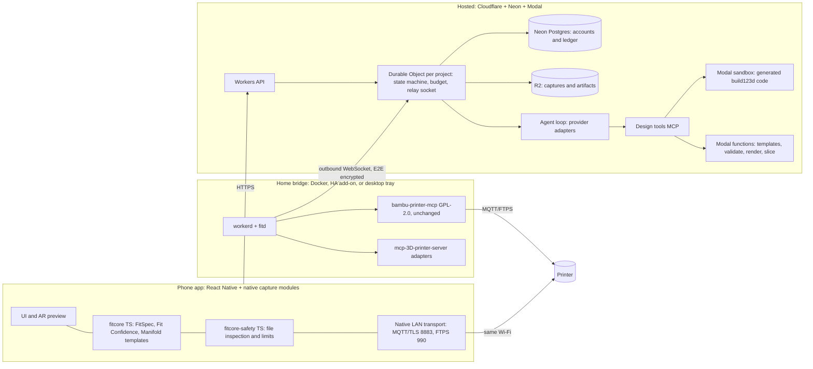

# Made to Fit: scan-to-print PRD

**Working name:** Made to Fit. **Version:** 2.0, research baseline 2026-10-14. **Status:** product and technical proposal for review. Nothing here is built, deployed, store-reviewed or physically printed.

**Evidence rules.** Every number carries a source link, a repository path, or the label **(est.)**. Numbers produced by the cost model are labelled **(model)**; their inputs are themselves cited or estimated in [`cost-model/inputs.json`](cost-model/inputs.json), and anyone can rerun them with `python3 docs/prd/cost-model/fit_cost_model.py`. Vendor benchmark claims are marked vendor-reported. Where a fact could not be verified it is stated as unknown, not filled in.

**Repository baseline.** Branch `cursor/scan-to-print-prd-f892` on top of release 1.1.26 (commit `c732b70`). Facts about the existing MCP server cite files in this repository.

---

## 0. The decision in one page

Build a free, open-source iOS and Android app that turns "make this fit that" into a printed part that fits **on the first full print**. A nontechnical owner points the phone at two things (a cup and a too-narrow cup holder, a drawer and the bottle parts that belong in it), says what they want, and gets a part designed to fit within the accuracy a phone can actually measure.

The plan rests on five bets. Each is falsifiable by a decision gate in §19.

| # | Bet | Why it wins | Gate |
|---|---|---|---|
| 1 | **Design for the measurement you have.** Phone depth is centimetre-class ([Luetzenburg 2021](https://www.nature.com/articles/s41598-021-01763-9)); FFF fits need tenths of a millimetre ([izdelaj.si](https://izdelaj.si/en/guide/natancnost-tolerance)). So the designer picks *compliant* interface architectures (crush ribs, flex fins, split collets, TPU sleeves, adjusters) whose tolerance window exceeds the measurement's uncertainty. It escalates to a one-print **Fit Key** only when it must. | Turns the hardest unsolved problem (precise phone metrology) into a design rule. The Codex PRD treats it as a measurement problem. | DG1, DG2 |
| 2 | **Template-first, code-second, model-last.** A library of parametric fit templates (Manifold geometry, runs on the phone) handles the wedge. A frontier model writes free-form CAD code only when no template applies. | Template fits cost about **$0.25 per delivered design** vs **$1.57** for free-form (model). Slider edits run on-device for $0. | DG3 |
| 3 | **FitBase: a community library keyed by the interface, not the object.** Designs are indexed by a measured interface signature (e.g. "tapered recess Ø66→71 mm, 58 mm deep"). Your scan of your cup holder finds adapters that already fit other people's identical holders, with their fit reports. | Network effect plus near-zero marginal cost: a remix is about **$0.02** (model). Bambu's MakerWorld indexes models, not interfaces. | DG6 |
| 4 | **Reuse the safety code, don't port it.** Run this repository's existing TypeScript safety core on the phone. A narrow relicense makes that possible: `src/safety/` is 1,092 lines, 1,070 of them by the owner and 22 by two contributors (`git blame`). A home bridge running the unchanged GPL-2.0 server works from day one. | Codex's no-PC route needs a fresh native validator with an unresolved licence. Ours needs two contributor consents and a pure-function split. | DG4 |
| 5 | **Lean, scale-to-zero hosting.** Cloudflare Workers and Durable Objects (API, per-project actors and the bridge relay), Neon Postgres (ledger), R2 (artifacts), Modal (sandboxed CAD and slicing). The same Worker code runs self-hosted in the Apache-2.0 [`workerd`](https://github.com/cloudflare/workerd) runtime. | Fixed baseline about **$90/month** (est., §13) vs the **$250/month** Codex assumes. A relay for 10,000 bridges costs about **$0.35/month** plus the $5 plan minimum (model). | DG7 |

**Price card to test:** library remixes are free; a template fit is 1 credit; a free-form AI design is 6 credits; credits cost $0.53–0.70 each; **Fit+** is $7.99/month with 15 credits. Credits are charged only when a design passes validation. Green-confidence fits carry a **Fit-or-refund** guarantee. Contribution margins after store fees are 40–57% on packs (Apple Small Business rate and US web checkout) and 66% on Fit+ at expected use (model, §14).

**MVP:** template fits for two launch categories (cup and bottle adapters; Gridfinity drawer kits fitted to a scanned drawer and items), Fit Confidence, Fit Key, AR fit preview, hosted design, and printing through a home bridge. The phone same-LAN executor and FitBase sharing follow in public beta behind gates. Multi-vendor printing reuses [mcp-3D-printer-server](https://github.com/DMontgomery40/mcp-3D-printer-server) adapters behind the same `PrinterBackend` contract.

---

## 1. Problem, user and wedge

### 1.1 Who

A new Bambu owner who can follow a phone prompt but will never open CAD. Bambu is the right first ecosystem: CONTEXT reports it took a **37% share of global entry-level 3D-printer shipments in 2025**, in a segment whose shipments rose **26% for the year and 47% in Q4 2025** ([CONTEXT, 2026-04-15](https://www.contextworld.com/quarterly-industrial-3d-printer-shipments-rebound-amid-continued-record-breaking-entry-level-growth)). Bambu does not publish its installed base. Reported figures are "more than 1.2 million units" shipped (36Kr via [KrASIA](https://kr-asia.com/bambu-lab-nears-usd-100-billion-valuation-as-tencent-eyes-new-investment), period unspecified) and about 2.1 million units in 2025 (an app-download inference by [AInvest](https://www.ainvest.com/news/bambu-lab-10-billion-bet-charity-contest-pr-platform-flywheel-real-story-2605/), low confidence). **The true installed base is unknown.** The planning assumption is "seven figures" and is not used in any financial calculation. This PRD deliberately contains no TAM dollar figure: no defensible source exists for one.

### 1.2 The job

> "I have *this thing* and *this place*. Make me *something that connects them*, and make it fit the first time."

Three properties make this a sharp consumer wedge rather than "AI CAD for everyone":

1. **The value is the fit, not the shape.** Generic adapters already exist on MakerWorld; what users lack is one that fits *their* holder. Fit is measurable, so success is unambiguous.
2. **Most of these parts are a few interface features plus a body.** A cup adapter is two coaxial interfaces; a drawer kit is a grid plus pockets. They parameterize well, which is why templates can carry the wedge.
3. **A miss costs real filament and a print that can take hours**, so a product that reliably fits on the first full print earns trust and repeat use.

### 1.3 Launch categories

| Category | Owner example | Launch stage | Why |
|---|---|---|---|
| **A. Cup and bottle adapters** | Narrow car or stroller cup holder to a wide tumbler | MVP | Two round or tapered interfaces; a compliant base absorbs scan error; low consequence |
| **B. Fitted drawer and cabinet kits** | Dr. Brown's bottle parts organized in a specific drawer | MVP | Uses the MIT-licensed [Gridfinity](https://gridfinity.xyz/) open standard (42 × 42 mm grid, 7 mm height units, 0.25 mm clearance per side; [spec](https://www.printables.com/model/417152-gridfinity-specification)). The drawer only needs centimetre accuracy, because the baseplate is trimmed to fit and the bins are standard. |
| **C. Parametric twins** (scan and modify) | "Same knob, 10 mm longer"; replacement feet, caps, clips | Beta | Primitive fitting plus template match; see M6 |
| **D. Clamp mounts** | Phone mount on scanned mountain-bike handlebars for a specific iPhone | Beta, labelled *bench prototype* until a physical test plan passes | Loaded and vibrating; needs TPU liner, metal fasteners and retention tests |
| E. Under-cupboard hangers | Bottle-parts rack hanging under a cupboard | Beta | Mounting substrate and fastener choice needed |

**Use-class rules (enforced by the request classifier and template catalog, not a disclaimer):**

- *Child-restraint adjacent:* drop-in inserts for an existing removable cup holder only. Never designs that clip to a harness, shell or restraint. The app shows a manufacturer-accessory warning.
- *Food contact:* organizers store parts; the app makes no food-safe, dishwasher-safe or sterilizable claims.
- *Loaded or safety-relevant mounts:* category D only, with explicit limits.
- *Weapons and weapon parts:* refused, consistent with [App Review Guideline 1.1.3](https://developer.apple.com/app-store/review/guidelines/).

### 1.4 Non-goals for v1

Copying arbitrary objects for their looks (Bambu's MakerLab already does image-to-3D figurines); functional threads; watertight seals; resin or non-FFF processes; multi-part assemblies with moving joints beyond print-in-place hinges.

---

## 2. Positioning

### 2.1 Bambu

- **Bambu is unlikely to build environment-fit design on phones.** It is about to sell a dedicated scanner, the **S1**: FCC grant on 2026-09-22 (ID [2A6J8-DS001](https://fccid.ai/2A6J8-DS001)), 60 W, 5 GHz Wi-Fi, handheld with a trigger grip, launch "November 2026" ([product page](https://bambulab.com/en-us/s1), [3Druck](https://3druck.com/en/scanner/bambu-lab-s1-fcc-approval-marks-bambu-labs-first-portable-3d-scanner-06163234/)). Price, accuracy and scanning technology are unannounced ([3D Mag](https://www.3dmag.com/news/bambu-lab-to-enter-the-3d-scanning-industry-with-s1-in-november-2026/)). A free phone path to fitted parts competes with that sales motion. This is the owner's thesis and a reasonable inference, not a known Bambu plan.
- **But Bambu already ships generative tools.** MakerLab offers Image-to-3D with partner engines at 24–45 credits per model (350 credits for $3), plus parametric generators including **"Make My Desk Organizer"** ([MakerLab](https://makerworld.com/en/makerlab), [credit table](https://skipthecad.com/guides/makerworld-makerlab-tools/)). Our defensible difference is therefore *fit to measured surroundings*, compliant interfaces and fit evidence. "AI makes models" is not a difference.
- **Complement S1 rather than fight it.** S1 scans become a high-accuracy `CaptureSource` once Bambu documents the formats (§16). S1 owners get fit design; everyone else gets the phone.
- **Open slicers.** We support FULU OrcaSlicer-bambulab and stock OrcaSlicer (both AGPL-3.0, verified via the GitHub license API) alongside Bambu Studio, as this repo already does (`docs/FULU.md`). Bambu has every incentive to steer users to Studio and Connect.

### 2.2 Others

| Product | What it does | Gap we exploit |
|---|---|---|
| [Zoo Zookeeper](https://zoo.dev/blog/announcing-zookeeper) | Conversational B-rep CAD agent. Free tier with $10/month credit; Plus $20/month (~400 minutes); Pro $99/month | Engineer-oriented; no scan-to-fit, no printer execution, no fit evidence |
| AdamCAD | Parametric generation with sliders, $9.99–29.99/month ([third-party comparison](https://blog.texocad.ai/posts/text-to-cad-tools-comparison)) | No measurement of the user's world |
| Polycam and other scanners | Phone meshes | Meshes, not functional fits |
| MakerWorld MakerLab | Image-to-3D figurines; parametric generators | Not keyed to the user's environment; Bambu-only |
| Codex "Scan to Make" PRD | Rigorous safety and data model | Conservative, AWS-heavy, coupon-centric, priced at $3/$9/$39 per project; see §21 |

---

## 3. Magic moves

These are the things a user will tell a friend about. Each has a cheap mechanism and a test.

| ID | What the user sees | How it works | Cost per use | Test |
|---|---|---|---|---|
| **M1 Fits anyway** | "Your scan is only good to about ±3 mm here, so I gave the base flexible fins that grip anything from 64 to 70 mm." | **Interface architecture selector.** Each template family declares a compliance range *K*. Rigid fits need the measurement-plus-process uncertainty to fit inside the clearance window; crush ribs absorb about 0.2 mm ([Hackaday](https://hackaday.com/2020/10/15/adding-crush-ribs-to-3d-printed-parts-for-a-better-press-fit/), [AON3D](https://www.aon3d.com/applications/engineering-fits-how-to-design-for-3d-printed-assemblies/)); flex fins, split collets with a screw, and TPU sleeves absorb millimetres (K ranges est., calibrated in FitBench). | $0 (deterministic) | Q-FIT-01 |
| **M2 Fit Confidence** | A Green, Yellow or Red badge per interface, with the single cheapest action that would turn it green ("hold a card next to it", "enter one tape measurement", "print the 6-minute Fit Key") | The deterministic interval rule in §6.3; never a model opinion | $0 | Q-FIT-02: Green designs must fit at ≥ 90% (target) |
| **M3 Fit Key** | One small print with five stepped sizes and embossed numbers. "Try it on the cup holder. Which number slides in snugly?" Tap 3. | A template-derived coupon of only the critical interface, steps of 0.1 mm around nominal (est.). The result is a scoped `FitReport` (§7). | Compute only; about 6–12 min and ≤ 4 g of filament (est.) | Q-FIT-03 |
| **M4 Your printer prints its own ruler** | First print after pairing: a **FitTag** tile and a **Printer Fit Profile** card | FitTag: a tile with through-hole fiducials (high contrast on any paper, even in single-colour printing) that gives an absolute scale reference in photos. The printer's ±0.2 mm XY accuracy ([GrandpaCAD](https://grandpacad.com/en/tools/tolerance-fit-calculator)) over an ~80 mm tile is about 0.25% scale error (est.). Fit Profile: go/no-go pegs and holes that measure this printer, material and nozzle's hole shrinkage; FDM holes typically print 0.1–0.3 mm undersize ([GrandpaCAD](https://grandpacad.com/en/tools/tolerance-fit-calculator)), and one study tuned hole horizontal expansion to 0.13 mm ([MDPI 2023](https://www.mdpi.com/2227-9717/11/10/2810)). Applied to every later design. | About 15 min once per printer, material and nozzle (est.) | DG2 |
| **M5 See it in place** | Live AR preview of the designed part seated on the real cup holder before printing | GLB preview anchored to the captured interface frame (ARKit/ARCore) | $0 on-device | Q-UX-03 |
| **M6 Parametric twin** | Scan an existing knob, foot or bracket and get sliders: "same, but 10 mm taller, add a hook" | RANSAC primitive fitting (planes, cylinders, cones) on the scan, then a template-family match, then an editable recipe. Frontier models are weak at reconstructing CAD from images: BenchCAD's best frontier Vision2Code total is 0.397 (Gemini 3.1 Pro, thinking) vs 0.601 for a specialist model ([BenchCAD](https://arxiv.org/html/2605.10865)), so geometry comes from measurement, never from a model looking at photos. | Template-class cost | Q-GEO-04 |
| **M7 Someone already fit this** | "41 people with this holder printed this adapter; 92% say it fit" | **FitBase** (interface-keyed library) plus a **Known Object Registry** of canonical dimensions for popular items, with provenance (manufacturer specification, crowd measurement, or verified by fit reports). Selecting "Stanley 40 oz" can skip scanning the cup entirely. | About $0.02 per remix (model) | DG6 |
| **M8 Instant sliders** | Drag "height" and the part updates immediately, with no wait and no credit | Recipes are data (template id plus parameters), evaluated by the same Manifold kernel on the phone, bridge and cloud. Not downloaded code, which keeps [App Review 2.5.2](https://developer.apple.com/app-store/review/guidelines/) satisfied. | $0 | Q-GEO-02 |
| **M9 One FitSpec, many machines** | The same drawer spec can also output a laser-cut acrylic lid or a cut-foam insert | A `FitSpec` is machine-independent. Output adapters target FFF now, then H2C/H2D 10 W and 40 W laser and cutting modules ([H2C FAQ](https://wiki.bambulab.com/en/h2c/manual/h2c-faq)), the A2L blade and pen ([3DPI](https://3dprintingindustry.com/news/new-bambu-lab-a2l-3d-printer-technical-specifications-and-pricing-252057/)), and the R1 55 W CO₂ laser ([Bambu](https://blog.bambulab.com/big-job-light-work-bambu-lab-launches-r1/)) | Output-adapter cost | §16 |
| **M10 Fit-or-refund** | "If a Green design doesn't fit after you used the Fit Key, your credits come back." | A policy on top of M2. A claim needs a photo; the claim rate is modelled at 5% (est.) | Priced into §14 | Q-BIL-05 |
| **M11 Household memory** | "Use the cup holder from your Outback scan?" | Measured interfaces persist privately and are reusable across projects | $0 | — |

---

## 4. Requirements

IDs are stable; acceptance evidence is in §18.

### 4.1 Product (W)

| ID | Requirement |
|---|---|
| W01 | The first-run path is: pair printer, print FitTag and Fit Profile, start a fit. A user with a supported printer reaches a printed Fit Key without reading documentation. |
| W02 | Objects, interfaces, the target space and desired behaviour are separate first-class inputs (aligned with Codex P01; we agree). |
| W03 | Every fit-critical dimension shows its source (registry, caliper, tape, FitTag photo, LiDAR, inferred) and its uncertainty in plain words. |
| W04 | The free tier includes capture, AR preview, library remixes, on-device slider edits, export and self-host connection, with no account required for self-host. |
| W05 | Use-class rules (§1.3) are enforced before any paid work starts. |
| W06 | A design states what it was checked for ("fits the measured holder; not tested for crash loads") separately from what it was not. |
| W07 | Before any paid design, the app checks that the selected printer has a working print route (§9), so nobody pays for a design they can't print. |

### 4.2 Capture (C)

| ID | Requirement |
|---|---|
| C01 | Detect capabilities at runtime (LiDAR scene depth, ObjectCaptureSession `isSupported`, ARCore Depth) and offer only working modes |
| C02 | Capture interfaces at close range separately from the space; never upload a whole room when a crop is enough |
| C03 | Keep intrinsics, poses, depth confidence, units and device/SDK metadata with every capture; canonical geometry is millimetres, Z-up, right-handed |
| C04 | Scale is established by at least one of: LiDAR metric depth, FitTag, ISO/IEC 7810 ID-1 card (85.60 × 53.98 mm), a manual dimension, or a registry object. Photo-only captures without scale are blocked from fit-critical use. |
| C05 | Transparent, reflective, thin or hidden surfaces mark the feature "unmeasured" and trigger a targeted question, never invented geometry |
| C06 | Capture works offline; uploads are resumable, de-duplicated by content hash and opt-in |

### 4.3 Fit and geometry (F)

| ID | Requirement |
|---|---|
| F01 | Each interface stores feature type, parameters, a measured interval, provenance and residuals (as in Codex G01–G03; we agree) |
| F02 | The interface architecture selector chooses rigid or compliant designs by the rule in §6.3; the choice and its reason are shown |
| F03 | Fit Confidence is computed only by deterministic code; the model may explain it but cannot set it |
| F04 | Fit Key results update only the interface, printer, nozzle, material and orientation scope they were measured in |
| F05 | The Printer Fit Profile corrections apply globally for that printer, material and nozzle and are invalidated by changes to any of them |
| F06 | Every candidate passes independent checks: manifoldness, positive volume, expected component count, minimum wall (≥ 2 extrusion widths, est.), build-volume fit for the selected model (volumes in `src/safety/limits.ts`), and interface clearance over the full insertion depth |
| F07 | An edit preserves protected interfaces unless the user explicitly changes them; a change to an interface invalidates its Fit Key result |

### 4.4 Design runtime (D)

| ID | Requirement |
|---|---|
| D01 | Pipeline order: registry/FitBase match, then template instantiation, then free-form code. Escalation is visible to the user and never re-priced mid-job. |
| D02 | The model gets only design tools (§8.3); it never sees printer credentials and has no print, heat or motion tool |
| D03 | Generated code runs only in a network-blocked gVisor sandbox with no secrets ([Modal sandbox networking](https://modal.com/docs/guide/sandbox-networking)) or in a self-host local container without network |
| D04 | Hard budgets: tokens, dollars and iterations per job (free-form: 6 iterations, stopping after 2 consecutive iterations without validator progress). Exhausting a budget returns the best valid candidate or an actionable failure. |
| D05 | Every candidate records model id and version, prompt-policy version, tool and image digests, parameters and output hashes |
| D06 | The design tools are also published as an MCP server, so self-hosters can drive them from any MCP client |

### 4.5 Execution (X), hosted (H), billing (B), licensing (L), security (S)

These are specified in §9, §12, §15, §10 and §17 respectively. Summary IDs:

- **X01–X10:** printer routes, preflight and dispatch.
- **H01–H08:** isolation, quotas and service objectives.
- **B01–B10:** ledger, quotes and refunds.
- **L01–L06:** licences and distribution.
- **S01–S10:** security and privacy.

---

## 5. Architecture: one codebase, three shapes



| Shape | Who | Runs | Printing |
|---|---|---|---|
| **Hosted** (paid convenience) | Most consumers | Our Workers, Durable Objects, Neon, R2 and Modal; our model keys | Phone same-LAN executor, home bridge, or export |
| **Home bridge** (free, self-host) | Self-hosters, Home Assistant users, anyone wanting remote monitoring | The same Worker code in `workerd` with SQLite-backed Durable Objects ([workerd SQLite DO storage](https://github.com/cloudflare/workerd/pull/302)); local container workers; bring-your-own model key or a local model; the unchanged `bambu-printer-mcp` | Bridge MQTT/FTPS (all routes the MCP supports, including the X2D native helper on macOS) |
| **Phone-only** (free, offline-capable) | Template fits without any server | On-device Manifold templates, Fit Confidence, `fitcore-safety`. On-device language model where available ([Apple Foundation Models](https://www.apple.com/newsroom/2025/09/apples-foundation-models-framework-unlocks-new-intelligent-app-experiences/), free, iOS 26). No free-form design and no cloud slicing. | Phone executor, plus a slice from a bridge or the user's own slicer |

### 5.1 Component decisions

| Layer | Decision | Rejected alternative and why |
|---|---|---|
| Mobile | **React Native (Hermes) shell + native Swift/Kotlin modules** for capture (ARKit scene reconstruction, Object Capture, ARCore Depth), AR preview views, LAN sockets and Keychain/Keystore | Two fully native apps (Codex): roughly twice the UI work, and no way to share the TypeScript core with this repo. Fallback if gate DG5 fails: move capture screens fully native and keep the RN shell. |
| Shared core | **`fitcore` (TypeScript):** FitSpec types and validation, Fit Confidence, template parameter schemas, and a Manifold binding (C++ via JSI on the phone; WASM or native elsewhere; [Manifold](https://github.com/elalish/manifold) is Apache-2.0 and used by OpenSCAD and Blender per its README) | Python-only CAD everywhere: can't run on the phone, so slider edits would cost a cloud round trip |
| Safety core | **`fitcore-safety` (TypeScript):** `src/safety/` split into pure functions (file and archive inspection, limits, state evaluation over a parsed report) with I/O behind ports | Native rewrite: duplicates heavily tested logic and adds an unresolved licence question |
| Control plane | **Cloudflare Workers + one Durable Object per project.** The single-threaded actor serializes mutations; storage is transactional; alarms provide durable timers; the relay uses hibernating WebSockets ([DO WebSockets](https://developers.cloudflare.com/durable-objects/best-practices/websockets/)) | AWS API Gateway, Lambda, Step Functions, SQS, Aurora and Cognito (Codex): more services, a higher fixed floor, and WebSocket connection-minute charges |
| Ledger | **Neon Postgres** (Launch plan: $0.106/CU-hour, $0.35/GB-month, scales to zero after 5 idle minutes ([Neon](https://neon.com/docs/introduction/plans))) for money and accounts only. Project state lives in Durable Objects. | Aurora Serverless v2 writer plus reader (Codex) |
| Blobs | **R2:** $0.015/GB-month, no egress fees ([R2](https://developers.cloudflare.com/r2/pricing/)). Captures are downloaded to workers and phones repeatedly, so zero egress matters. | S3 plus egress |
| Compute | **Modal.** Functions for trusted pinned code (template build, validation, render, slicing); Sandboxes for model-generated code (gVisor, `block_network=True`, no secrets) ([Modal](https://modal.com/docs/guide/sandbox-networking)); an L4 GPU only for optional photogrammetry. Per-second billing ([pricing](https://modal.com/pricing)). Evaluate Restricted Functions (`restrict_modal_access`, `block_network`, `single_use_containers`) ([docs](https://modal.com/docs/guide/restricted-access.md)) as a cheaper isolation option if they bill at Function rates (to verify). | Fargate task per job (Codex): slower cold start for interactive edits; the CPU is cheaper, but compute is only 3–8% of AI-design cost (model) |
| Geometry | **Manifold templates** for every launch category; **build123d** (Apache-2.0) for free-form B-rep and STEP export; **Open3D, trimesh and pyRANSAC-3D** for scan feature fitting; Blender stays an optional self-host path through the existing MCP bridge (`src/blender-mcp-bridge.ts`) | CadQuery default (Codex): fine, but build123d is what the CADGenBench reference agent uses ([CADGenBench](https://github.com/huggingface/cadgenbench/blob/a47c9513/README.md)); both are evaluated in DG3 |
| Slicing | Pinned FULU OrcaSlicer-bambulab / Bambu Studio CLI in a Modal function (hosted) or `bambu-printer-mcp` `slice_stl` (bridge). The existing exact-machine-preset and profile safety gates apply (AGENTS.md "Printer and slicer safety"). | Phone slicing: no supported mobile slicer CLI |
| Relay | Bridge dials out to its project-owner Durable Object; the phone connects to the same object. Payloads are end-to-end encrypted between paired device keys; the relay sees metadata only. | Tailscale as the default: iOS allows one active VPN configuration at a time, and Tailscale's free Personal plan is for non-commercial use ([pricing](https://tailscale.com/pricing)). Tailscale stays an *option* for self-hosters. |

### 5.2 Leaner alternatives considered and rejected

| Alternative | Why not |
|---|---|
| Everything on the phone, no backend | Free-form design needs frontier models; there is no slicer CLI on mobile; captures are lost without sync |
| A single VM running everything | Always-on cost, manual patching, no isolation boundary for generated code |
| Supabase instead of Neon | A paid project runs a VM around the clock (Neon's comparison cites a ~$10/month Micro within the $25/month Pro plan ([Neon FAQ](https://neon.com/faqs/affordable-managed-postgres-options-startups))). Acceptable, but Neon scales to zero. |
| Bambu cloud APIs for remote printing | No public consumer delegated API. Firmware with the authorization system blocks third-party print starts in cloud mode ([Bambu wiki](https://wiki.bambulab.com/en/software/third-party-integration)). |

---

## 6. Capture and measurement

### 6.1 Devices

| Tier | Devices | Modes |
|---|---|---|
| T-LiDAR | iPhone 12 Pro through 17 Pro and Pro Max; LiDAR iPads. The iPhone 17 and iPhone Air have no LiDAR ([17 Pro specs](https://www.apple.com/iphone-17-pro/specs/), [17 specs](https://www.apple.com/iphone-17/specs/)). | Scene depth for spaces; Object Capture where `isSupported` (the sample requires LiDAR, A14 or later and iOS 18 ([Apple](https://apple-docs.everest.mt/docs/realitykit/scanning-objects-using-object-capture/))) |
| T-Depth | Android devices with ARCore Depth (depth from motion, plus ToF if present; most accurate at 0.5–5 m ([ARCore](https://developers.google.com/ar/develop/depth))) | Depth fusion for spaces; FitTag photos for interfaces |
| T-Photo | Any phone | FitTag or card-scaled photos plus prompted measurements; optional cloud photogrammetry |

### 6.2 What phone depth can and cannot do

| Evidence | Result | Implication |
|---|---|---|
| [Luetzenburg et al. 2021](https://www.nature.com/articles/s41598-021-01763-9), iPhone 12 Pro | ±1 cm absolute accuracy for objects over 10 cm; precision degrades below 10 cm; detection limit about 5 cm | Good for drawers, shelves and handlebar *positions*; useless for a 0.2 mm fit |
| [Vogt et al. 2021](https://www.mdpi.com/2227-7080/9/2/25), iPad Pro | The LiDAR mesh was too coarse to evaluate Lego bricks. The front TrueDepth camera reached 0.41–1.17 mm mean form deviations vs 0.14–0.96 mm for an industrial scanner. | Close-range small features need a different source |
| [ARCore depth evaluation](https://pdfs.semanticscholar.org/741b/0bb535ee3627ce433d9954d869e43718f57c.pdf) | Depth differences of about 8 cm reported; error grows with distance; the authors limit capture to 4 m | Android depth is for coarse envelopes only |
| Apple LiDAR specification | **No accuracy specification published.** The earlier "±1%" claim in v1 of this PRD was unsourced and is withdrawn. | Calibrate per device class (DG1) |

**Measurement sources ranked for fit-critical interfaces.** Uncertainties are starting estimates to be replaced by DG1 data:

1. Known Object Registry entry: ±0.3 mm (est.)
2. Caliper entry: ±0.1 mm (est.)
3. FitTag close-range photo: ±0.5 mm (est., hypothesis)
4. Tape or ruler entry: ±1 mm (est.)
5. LiDAR or depth mesh: ±10 mm (per Luetzenburg)

### 6.3 The fit rule (Fit Confidence)

For each interface:

- *W* is the clearance window per side for the chosen fit class. Starting values: press 0.05–0.15 mm, sliding 0.2–0.3 mm, loose 0.4–0.6 mm ([izdelaj.si](https://izdelaj.si/en/guide/natancnost-tolerance), [Sovol](https://www.sovol3d.com/blogs/news/fdm-3d-printing-tolerances-clearances-how-to-design-parts-that-fit)).
- *U_m* is the measurement half-width from the source table in §6.2.
- *U_p* is the process half-width: ±0.2 mm by default ([GrandpaCAD](https://grandpacad.com/en/tools/tolerance-fit-calculator)), or the calibrated value from the Printer Fit Profile.
- *K* is the compliance range of the chosen interface architecture.

Uncertainties are combined linearly (worst case), not root-sum-square, because independence is unproven. Codex adopts the same rule, and we agree with it.

| Badge | Condition | Action shown |
|---|---|---|
| **Green** | *U_m + U_p ≤ 0.8 · (W + K)/2* | Print |
| **Yellow** | The Fit Key tested size range covers the complete measurement interval, and Green would hold using its validated residual uncertainty (±0.05 mm step half-width, est.) | "Print the Fit Key first (about 8 min, est.)" |
| **Red** | Neither holds, or a feature is unmeasured | Ask for the cheapest better measurement, or switch to a more compliant architecture |

A five-size coupon spaced 0.1 mm around nominal covers only ±0.2 mm. It cannot resolve a ±1 mm tape measurement: request a better measurement or design a wider coupon that covers the complete interval before offering Yellow. After testing, require a confirmed fitting size and retain process uncertainty; no fitting size or a boundary-only result requires a wider coupon or new measurement, never an automatic Green badge.

The selector tries architectures from stiffest to most compliant and picks the first one that yields Green or Yellow and also satisfies the use class (for example, rigid for Gridfinity bins, flex fins for cup bases, split collet plus TPU for handlebars).

### 6.4 Scan processing

On the device: crop to the selected region, freeze mesh anchors, and run a coverage check. On a worker or the bridge: plane and cylinder or cone RANSAC with residuals, and drawer envelope extraction (largest inscribed box with keep-outs for rails and hinges). Interface surfaces are **never remeshed or decimated** (consistent with the repo's Blender bridge caution that remeshing can erase fit surfaces, README "Blender MCP"). Poisson-filled regions are marked as inferred. RTAB-Map (BSD-licensed; see [repo](https://github.com/introlab/rtabmap)) stays an evaluated option for multi-view fusion of spaces, not a launch dependency.

---

## 7. Versioned data contracts

All contracts are JSON with `schema` identifiers of the form `urn:mtf:<name>:<major>.<minor>`. Minor versions are additive only; readers ignore unknown fields; a major change requires a migration and dual-read for one release. Units are millimetres and degrees; floats must be finite; money and credits are integers (micro-credits); hashes are SHA-256 hex; timestamps are UTC RFC 3339. JSON Schemas and TypeScript types are generated from one source in `fitcore`, and the Python workers consume the same schemas.

### 7.1 FitSpec (the design intent)

The values below are illustrative, not measurements.

```json
{
  "schema": "urn:mtf:fitspec:1.0",
  "id": "fs_…", "revision": 7, "project_id": "pj_…",
  "use_class": "household_adapter",
  "category": "cup_adapter",
  "interfaces": [
    {
      "id": "host.recess", "role": "host", "feature": "tapered_recess",
      "params": {"d_top": {"nom": 71.2, "lo": 70.4, "hi": 72.0}, "d_bottom": {"nom": 66.0, "lo": 65.2, "hi": 66.8}, "depth": {"nom": 58, "lo": 56, "hi": 60}},
      "source": "fittag_photo", "source_ids": ["cap_…"], "residual_rms": 0.21,
      "fit_class": "sliding", "protected": true
    },
    {
      "id": "guest.cup", "role": "guest", "feature": "cylinder",
      "params": {"d": {"nom": 98.5, "lo": 98.2, "hi": 98.8}, "height": {"nom": 260, "lo": 255, "hi": 265}},
      "source": "registry", "registry_id": "kor_stanley_quencher_40oz_v1"
    }
  ],
  "space": {"envelope": null, "keep_outs": []},
  "intent": {"text": "hold my 40 oz tumbler in the car", "constraints": [{"kind": "max_height_above_host", "value": 40}]},
  "process": {"printer_model": "p1s", "nozzle_mm": 0.4, "material": "PETG", "fit_profile_id": "fp_…"},
  "unresolved": []
}
```

### 7.2 The other contracts

| Contract | Key fields and invariants |
|---|---|
| `capture:1` | Device and SDK, mode, intrinsics, pose list, depth confidence, scale source, content hash, consent flag |
| `recipe:1` | `template_id@version` + params **or** `code_sha` + sandbox image digest; kernel version; `fitspec_revision` it satisfies |
| `fitproof:1` | Validator version, check results (manifold, volume, components, min wall, build volume, per-interface clearance over depth), Fit Confidence per interface with inputs (*W, U_m, U_p, K*), renders with camera matrices. **Only the validator writes it.** |
| `printplan:1` | Candidate hash, printer capability record version, model, nozzle, plate, material/AMS mapping, slicer image and profile hashes, `.gcode.3mf` hash |
| `approval:1` | Actor and device, print plan hash, printer serial observed, expiry (5 min, est.), one-use nonce |
| `dispatch:1` | Executor id (phone or bridge), unique remote name, inspected-snapshot hash, receipt, `observed_state ∈ {sent, started, unconfirmed, uncertain, rejected}`; mirrors the repo's `dispatch: "started" \| "unconfirmed"` (README `print_3mf`) |
| `fitreport:1` | Scope (interface id, printer serial, model, nozzle, material, orientation, fit profile), result (`too_tight` / `snug` / `loose` / `step:n`), optional measurement, photo hash |
| `fitbase-entry:1` | Interface signature (feature types plus interval parameters, CC0), recipe (user-chosen licence, default CC-BY-4.0), aggregate fit reports, moderation state, author pseudonym. **No scans, rooms or locations.** |
| `capability:1` | Device class, model, firmware range, route, operation, evidence level `announced → documented → fixture → integration → hardware-verified`, source links |
| `ledger-event:1` | Idempotency key, account, lot, kind (`purchase`, `hold`, `settle`, `release`, `refund`, `grant`), integer micro-credits, price-card version, causal job id |

### 7.3 State machines

Each project's Durable Object holds the authoritative state. Every transition is appended to the project event log with the revision it applies to; a message answering an older revision is rejected.

| Machine | States | Notes |
|---|---|---|
| Project | `draft → capturing → measuring → spec_ready → quoted → designing → review → (fit_key_printing → fit_recorded)? → accepted → planning_print → printing → printed → fit_reported` | Side exits: `needs_measurement`, `needs_input`, `unsupported_use`, `cancelled` |
| Design job | `held → intake → matching → templating ⇄ validating → (escalated → coding ⇄ validating)? → critiquing → delivered \| failed_released` | `held` = credits on hold; `delivered` settles credits; `failed_released` releases them |
| Print (per executor) | `planned → inspected → preflight_ok → awaiting_human → approved → journaled → sent → started \| unconfirmed \| rejected \| uncertain` | `uncertain` needs reconciliation by job name and subtask before any further print on that printer |
| Ledger | `purchase_pending → purchased`; `hold → settle \| release`; `refund` | Append-only; refunds are compensating entries |

### 7.4 Retry classes

| Class | Operations | Policy |
|---|---|---|
| R0 pure compute | Template build, validate, render, slice | Automatic retry ×3 with backoff; outputs are content-addressed, so duplicates are harmless |
| R1 provider call | Model requests | Idempotency key per turn; on timeout, reconcile usage by request id before retrying; counts against the budget |
| R2 human-gated | Questions, approvals | Never retried; expire after a timeout (10 min default, mirroring `BAMBU_CONFIRMATION_TIMEOUT_MS` in CHANGELOG 1.1.17) |
| R3 physical | Upload-and-start, heater-on, resume | **Never retried automatically.** Journal intent, send once, then reconcile. Stop and heater-off are exempt and may be retried freely. |

| Event | Required behaviour |
|---|---|
| App killed during design | The job continues within its credit hold; results arrive on reconnect |
| App killed during dispatch | On relaunch, read the journal; query the printer for the job name; show `uncertain` until resolved; no replay |
| Printer state changes after approval | Abort; fresh preflight; a new approval is needed |
| User edits a dimension mid-job | The job is superseded at its next checkpoint; the old candidate cannot be accepted for the new spec |
| Provider outage | Checkpoint; fail over only to a FitBench-qualified model within the remaining budget |
| Duplicate store notification | Verify with the store server and de-duplicate by transaction id |
| Bridge offline | Phone and stick routes stay available; status shows "stale since …" |

---

## 8. Agentic design runtime and model policy

### 8.1 Pipeline

1. **Intake** (cheap model or on-device model): parse the request into a draft FitSpec patch and a use class; ask at most two questions.
2. **Match:** query the registry and FitBase by interface signature. A hit offers a free remix.
3. **Template planner:** choose a template family and parameters, run the deterministic build, validate and render, and repeat up to 4 turns.
4. **Free-form coder** (only when no template applies or the template fails): write build123d code in the sandbox, validate and render, and repeat up to 6 iterations with the no-progress stop.
5. **Critic:** one multimodal check of the final renders against intent. It can only *flag*; the validator decides pass or fail.

### 8.2 Model choice (October 2026 prices, verified)

| Model | Input / cached / output per M tokens | Notes |
|---|---|---|
| Claude Opus 5.5 | $4 / $0.20 / $20; 5-min cache write $5 ([Anthropic](https://platform.claude.com/docs/en/about-claude/pricing)) | Vendor-reported leader on agentic coding (Terminal-Bench 4.0 66.4% vs GPT-6 Astra 57.9%; CursorBench 4.0 57.8% vs GPT-5.6 Sol 41.7%). The vendor itself warns that benchmark margins are a less reliable guide ([Anthropic](https://www.anthropic.com/claude-opus-5-5)). High-resolution vision tier. |
| Claude Sonnet 5.5 | $2 / $0.10 / $10 ([Anthropic](https://platform.claude.com/docs/en/about-claude/pricing)) | Planner and critic default |
| GPT-6.1 Sol | $2 / $0.10 / $10; cache write $2.50 ([OpenAI](https://developers.openai.com/api/docs/pricing)) | Planner challenger at the same price |
| GPT-6 Luna | $0.10 / $0.01 / $0.50 ([OpenAI](https://developers.openai.com/api/docs/pricing)) | Intake default |
| GPT-6 Astra | $10 / $1 / $50 ([OpenAI](https://developers.openai.com/api/docs/pricing)) | Not used by default; 2.4× Opus cost for free-form (model) |
| Gemini 4 Argon | $2 / $0.10 / $10 through 2026-11-30, then $4 / $0.20 / $20; no free tier ([Google](https://ai.google.dev/gemini-api/docs/latest-model)) | Released 2026-10-13 ([PPC Land](https://ppc.land/google-prices-gemini-4-argon-at-2-per-million-tokens-paid-users-only/)); evaluate in FitBench |
| Gemini 3.8 Flash | $0.75 / $0.075 / $3.75 through 2026-12-31, then $1.50 / $0.15 / $7.50 ([Google](https://ai.google.dev/gemini-api/docs/pricing)) | The free tier is marked "used to improve products", so **never send user data on the free tier** |
| Grok 4.7 | $2 / $0.50 / $6 (<200k context), 500k context, image input, no batch ([xAI](https://docs.x.ai/developers/models/grok-4.7)) | Cheapest frontier output; failover candidate |
| Apple Foundation Models | Free on-device (~3B parameters), guided generation and tool calling ([Apple](https://www.apple.com/newsroom/2025/09/apples-foundation-models-framework-unlocks-new-intelligent-app-experiences/)); free Private Cloud Compute for Small Business Program developers with under 2M first-time downloads ([Apple](https://developer.apple.com/foundation-models-framework/)) | iOS intake at $0 |

**Decision:**

| Role | Default | Why |
|---|---|---|
| Intake | Apple on-device model (iOS, where available), otherwise GPT-6 Luna | Near-zero cost |
| Planner and critic | Claude Sonnet 5.5 | Low cost; can be replaced by GPT-6.1 Sol if FitBench shows it is better |
| Free-form coder | Claude Opus 5.5 | Most expensive role but the hardest task. On BenchCAD Vision2Code its predecessor Opus 4.7 had the highest code-execution rate among frontier models (94.0%), though Gemini 3.1 Pro (thinking) scored higher on IoU (0.279 vs 0.274) and total (0.397 vs 0.383) ([BenchCAD](https://arxiv.org/html/2605.10865)), so this choice is provisional. Claude models also led an earlier executable-test CAD benchmark ([CADTestBench](https://www.alphaxiv.org/abs/2605.07807)), and cache reads at 0.05× input favour long tool loops. Gemini 4 Argon is the first challenger in DG3. |

Rationale: the expensive failure is a wasted print and a lost user, not tokens. Even so, the free-form coder accounts for over 90% of free-form LLM cost (model). A switch to Sonnet 5.5, GPT-6.1 Sol or Grok 4.7 cuts free-form cost per delivered design from $1.57 to $0.79–0.88 (model, `scenarios.csv`). That switch is **gated by FitBench**: allowed if the challenger's first-print fit rate is within 3 points of the default (DG3).

Evidence that shapes the runtime:

- Frontier models struggle to reconstruct CAD from images (BenchCAD Vision2Code totals ≤ 0.40) but edit CAD code well (BenchCAD-Edit accuracy 0.853–0.865).
- Code-based generation beats specialized command sequences ([Text2CAD-Bench](https://arxiv.org/html/2605.18430v1)).
- A 2B open model fine-tuned on BenchCAD reached a Vision2Code total of 0.768, above every frontier model. Fine-tuning a small open model on our own template and FitBench corpus is therefore a later cost lever (open question 7).

So the model gets **measured numbers and code**, and renders only for critique.

### 8.3 Tools (the complete list)

`get_fitspec`, `propose_fitspec_patch` (returns a diff for the user to confirm), `search_registry`, `search_fitbase`, `list_templates`, `instantiate_template`, `build_freeform` (sandbox), `validate` (writes the FitProof; the model cannot), `render`, `ask_user`, `request_measurement`, `propose_fit_key`.

There is no print, heat, move, credential or billing tool. Tool output and imported metadata are untrusted data. Each tool has a JSON Schema, deadline, output-size cap and idempotency key.

### 8.4 FitBench (the evaluation that decides models and templates)

- **Fixtures:** 40 fixtures (est.): 15 cup and bottle adapter hosts (real cup holders, including tapered and oval), 10 drawers with item sets, 8 twins, 7 clamps. Each has caliper-measured ground truth and is captured by 3 phones × 3 repeats.
- **Prompts:** 5 phrasings per fixture, including vague and contradictory ones.
- **Scoring:**
  - Primary: **first-print fit** on a P1S and an A1 (physical).
  - Secondary: validator pass, questions asked, cost, wall time and Fit Confidence calibration (Green fit rate).
- **Fairness:** same budget and harness for every model, no hand rescue, pinned model ids and price-card versions. Held-out fixtures are never used for prompt tuning.

---

## 9. Printer connectivity: what is actually possible

### 9.1 The firmware facts

- **Authorization firmware (January 2025).** Print starts over LAN or cloud, motion, temperature, fans, AMS and calibration now require authorization. **Status pushes and starting prints from an SD card are not restricted** ([Bambu blog](https://blog.bambulab.com/firmware-update-introducing-new-authorization-control-system-2/), [wiki](https://wiki.bambulab.com/en/software/third-party-integration)).
- **Bambu Connect** is the authorized desktop middleware (Windows and macOS). It needs neither internet nor an account in LAN mode ([Bambu blog](https://blog.bambulab.com/updates-and-third-party-integration-with-bambu-connect/)). This repo already supports the `bambu-connect://import-file` hand-off on macOS (`src/bambu-connect.ts`).
- **Developer Mode** is enabled on the printer after LAN Only mode. It restores MQTT, FTP and live stream without authorization. It **disconnects Bambu Cloud** and is unsupported by Bambu ([wiki](https://wiki.bambulab.com/en/knowledge-sharing/enable-developer-mode)). **Bambu Handy does not support LAN mode** ([Handy guide](https://wiki.bambulab.com/en/studio-handy/handy/bambu-handy-quick-start)), so Developer Mode users lose Handy. Our bridge's remote status and camera (`camera_snapshot` in the README) replace it.
- Without Developer Mode, firmware 01.08.05+ rejects unsigned commands with HMS 0500-0500-0001-0007, which this repo detects (`src/printers/bambu.ts`; CHANGELOG 1.1.18).
- **Bambu Handy cannot import local files**; it prints only files sent from Studio or MakerWorld ([forum](https://forum.bambulab.com/t/open-stl-or-3mf-files-directly-in-the-app/92605), [wiki](https://wiki.bambulab.com/en/makerworld/tutorials/how-to-upload-models)).
- **Routes vary by model** (README `print_3mf`): files upload to the SD root on H2 and full-size A1, and to `cache/` on P1, X1, A1 mini and P2S. H2 and P2S use `ams_mapping2`. X2D prints only through the macOS native helper. Serial prefixes and the safety identity checks are in `src/safety/printer-state.ts`.

### 9.2 Routes we offer

| Route | Needs | Can | Cannot | Stage |
|---|---|---|---|---|
| **R-Bridge** | An always-on device on the LAN: Docker on a NAS or Raspberry Pi, a Home Assistant add-on (700,514 opt-in active installs reported, with fewer than a quarter of users estimated to opt in ([HA analytics](https://analytics.home-assistant.io/))), or a macOS/Windows tray app. Printer in Developer Mode. | All `bambu-printer-mcp` routes including X2D (macOS bridge), remote status, camera, stop, AMS inventory | Print on printers not in Developer Mode | **MVP** |
| **R-Phone** (same LAN) | The app in the foreground on the printer's Wi-Fi; Developer Mode | Inspect, preflight, upload, dispatch and stop; live AMS | Remote use; background MQTT (iOS background transfers cover HTTP only); X2D | Beta, gate DG4 |
| **R-Connect** | Bambu Connect desktop | Hand-off for user review and start | Automatic dispatch receipt | MVP (existing code) |
| **R-Stick** | USB or microSD; the printer's own screen. The X2D has USB and eMMC ([specs](https://bambulab.com/en/x2d/specs)); A1/P1/X1 take microSD ([SpeakCAD](https://speakcad.com/blog/bambu-lab-gcode-3mf-without-bambu-studio)). | Works on **every** firmware and mode, because SD-card starts are unrestricted | Live preflight; it is an *export*, so the screen prompts the user to check the model, nozzle and plate | MVP |
| **R-Vendor** (other brands) | A bridge with an mcp-3D-printer-server adapter | OctoPrint, Moonraker, Duet, Repetier, PrusaLink and Creality via `src/printers/*.ts` in that repo | Bambu-level file inspection unless the adapter implements it | Launch+ |

**The hosted tier on its own, with no phone on the LAN and no bridge, can:** capture, design, validate, slice with a pinned profile, show an AR preview, store, share and export. **It cannot:** start, heat, move, pause or stop a print; read live AMS; or verify printer identity. AGENTS.md requires fresh observed identity for every print route, so hosted-only users print by R-Stick or R-Connect. That limit holds for us and for every third party until Bambu offers a delegated API. We say so in the app before purchase (W07).

### 9.3 Execution requirements (X)

| ID | Requirement |
|---|---|
| X01 | Phone and bridge executors run the **same** `fitcore-safety` inspection on the exact bytes they upload, plus fresh identity, nozzle, ready and HMS checks, rechecked after the human confirmation (AGENTS.md safety rules) |
| X02 | Approval binds the print plan hash, observed serial and plate; any change invalidates it |
| X03 | Dispatch happens once; an uncertain outcome is reconciled by job name and subtask and **never auto-replayed** (repo's X2D uncertainty handling, CHANGELOG 1.1.26) |
| X04 | Stop, cancel and heater-off are always available, independent of billing, cloud reachability or agent health |
| X05 | LAN access codes stay in Keychain/Keystore or the bridge's OS store; never sent to the cloud, a model or logs |
| X06 | FTPS on the phone implements TLS session reuse on data channels; printers reject without it (`522 session reuse required`, README and CHANGELOG 1.1.14) |
| X07 | Pairing: one QR with the bridge's public key and a 5-minute nonce (est.), confirmed fingerprint, revocable device credentials |
| X08 | Unknown model, firmware or route combinations fail closed; the capability registry decides what is shown |
| X09 | The phone executor keeps a durable local journal (intent before send, receipt after) to survive app termination |
| X10 | R-Stick exports state their declared model, nozzle and plate in the file name and on screen, and are inspected for that model before export |

---

## 10. Licensing and distribution

### 10.1 Facts

- This repository's `LICENSE` is the GPL version 2 text; `package.json` declares `"license": "GPL-2.0"`.
- **The App Store conflict is real for GPL-2.0.** The FSF's position is that App Store usage rules impose "further restrictions" forbidden by GPLv2 §6 ([FSF via VideoLAN list, 2010](https://mailman.videolan.org/pipermail/vlc-devel/2010-November/077027.html)). VLC for iOS was removed after a copyright holder complained ([Ars Technica, 2011](https://arstechnica.com/gadgets/2011/01/vlc-for-ios-vanishes-2-months-after-eruption-of-gpl-dispute/)).
- GPLv3 §7 lets recipients remove further restrictions, which changes the analysis ([discussion](https://opensource.stackexchange.com/questions/9500/is-apple-allowed-to-distribute-gplv3-licensed-software-through-its-ios-app-store)). Rightsholder-published copyleft apps do ship: Signal-iOS is AGPL-3.0, Firefox for iOS is MPL-2.0, Home Assistant iOS is Apache-2.0 (GitHub license API).
- Any contributor's GPL-2.0 code embedded in an iOS binary is a takedown risk we do not control. **The iOS app must not contain GPL-2.0 code.**
- `src/safety/` blame: DMontgomery40 1,070 lines, Izzy Mansurov 16, nippo22 6. `src/printers/bambu.ts` is substantially by other contributors (Alex Buchan 1,103 lines, VailElla 56, and others), so **the transport is not a relicensing candidate**. Its MQTT and FTPS behaviour is re-implemented natively from the protocol documentation (OpenBambuAPI, GFDL-1.3) and this repo's README. Safety-core dependencies are permissive: `jszip` is MIT or GPL-3.0, and `bambu-node`, `mqtt` and `basic-ftp` are MIT (npm registry).

### 10.2 Plan (L)

| ID | Decision |
|---|---|
| L01 | Mobile app: **MPL-2.0.** File-level copyleft keeps our code open, is App Store-compatible (Firefox precedent), and is GPL-compatible for Android builds that bundle GPL parts |
| L02 | `fitcore-safety`: **GPL-2.0 OR MPL-2.0 dual licence**, with written consent from the owner and the two contributors for their 22 lines (or clean-room rewrites of those lines). Recorded in CONTRIBUTORS.md. Decision gate DG4. |
| L03 | `bambu-printer-mcp` stays GPL-2.0 and runs only in the bridge as a separate process over MCP. The hosted control plane is **AGPL-3.0**, so a hosted fork must share its source. GPL-2.0-only and AGPL-3.0 code never link: they talk over MCP or JSON. |
| L04 | Contracts, schemas and `fitcore`: **Apache-2.0**, so vendors and other apps can implement FitSpec |
| L05 | FitBase: interface signatures are CC0 (facts); recipes are under the author's chosen licence (default CC-BY-4.0); Gridfinity-derived templates keep the MIT notice ([Gridfinity](https://gridfinity.xyz/)) |
| L06 | Third-party obligations: Bambu Studio, Orca and FULU are AGPL-3.0 (run unmodified as CLIs; publish our worker image recipes); Blender GPL (optional worker); OCCT LGPL-2.1 ([repo](https://github.com/Open-Cascade-SAS/OCCT)); build123d and Manifold Apache-2.0; trimesh MIT; Bambu's networking plug-in is proprietary and never bundled (`docs/FULU.md`); ARCore is a proprietary Google runtime, so the F-Droid flavour drops depth and uses FitTag photos |

**Distribution:**

- App Store and Google Play.
- TestFlight: up to 10,000 external testers; builds expire after 90 days ([Apple](https://developer.apple.com/help/app-store-connect/test-a-beta-version/invite-external-testers)). This is a beta channel, not free permanent distribution.
- Self-builders can sideload; Xcode personal-team builds need periodic re-signing.
- An F-Droid build without proprietary SDKs; a signed APK on GitHub Releases.

The official build and self-builds are feature-identical; payment buys hosted compute, not features.

---

## 11. Safety: physical, use and model

- **Inherited invariants (AGENTS.md):** exact-file inspection; independent model, component and material temperature ceilings; fresh observed identity; human confirmation; finished-bed clearance; no auto-replay; stop and heater-off always available. Both executors must pass this repo's `tests/behavior.test.mjs` safety fixtures through `fitcore-safety` before a route is enabled (Q-EXE-01).
- **Use-class gating** (§1.3) happens before payment.
- **Agent boundary:** no physical tools (§8.3); generated code runs network-blocked in a sandbox; a design is "checked" only by a validator FitProof.
- **New hardware classes** (laser, cutter, scanner) get their own physical-action rules. They never inherit FFF guarantees. Laser output starts only after a separate safety review; Class 1 versus Class 4 operation matters for the R1 ([R1 store notes](https://us.store.bambulab.com/products/r1)).

---

## 12. Hosted operations (H)

| ID | Requirement |
|---|---|
| H01 | Generated code: Modal Sandbox, `block_network=True`, no secrets, single use, CPU, memory, disk and time limits, output-size cap; inputs and outputs only through exact-object signed URLs |
| H02 | Trusted workers (template, validate, render, slice) run pinned image digests and accept no code from tool results |
| H03 | One active design job per account (est.); per-tenant and global admission caps; budget holds before enqueue |
| H04 | Durable Object per project: all mutations serialized; alarms drive timeouts and human-wait expiry; every state change appended to an event log before notification |
| H05 | Service objectives (targets, not an SLA): template fit preview at p95 ≤ 20 s (est.); free-form first candidate at p95 ≤ 4 min (est.); API availability 99.9% (est.) |
| H06 | Recovery: Neon point-in-time restore (Launch plan history up to 7 days ([Neon](https://neon.com/docs/introduction/plans))); R2 object versioning; restore drills before paid launch |
| H07 | Observability: OpenTelemetry traces keyed by job id; no captures or secrets in logs |
| H08 | Self-host parity: the same contract tests run on hosted and `workerd` builds; migrations are tested in both directions |

---

## 13. Fixed costs

| Item | Monthly | Source |
|---|---|---|
| Cloudflare Workers Paid plan (includes Durable Objects allotments) | $5.00 | [Workers pricing](https://developers.cloudflare.com/workers/platform/pricing/) |
| Neon compute, 250 CU-hours (est.) × $0.106 | $26.50 | [Neon](https://neon.com/docs/introduction/plans) |
| Neon storage, 20 GB (est.) × $0.35 | $7.00 | [Neon](https://neon.com/docs/introduction/plans) |
| R2 base storage, 200 GB (est.) × $0.015 | $3.00 | [R2](https://developers.cloudflare.com/r2/pricing/) |
| Modal Starter plan (Team is $250/month when concurrency requires it) | $0.00 | [Modal](https://modal.com/pricing) |
| Error tracking, email and miscellaneous | $40.00 | est. |
| Apple Developer Program ($99/year) | $8.25 | [Apple](https://developer.apple.com/programs/) |
| **Total** | **$89.75** (model) | Per project: $0.90 at 100, $0.09 at 1,000, $0.009 at 10,000 projects/month (model) |

**Relay:** per connected bridge per month, 30 connects plus 2,000 inbound messages (est.) on hibernating WebSockets ([DO pricing](https://developers.cloudflare.com/durable-objects/platform/pricing/)) costs $0.0000355. For 10,000 bridges that is **$0.35/month** plus the $5 plan minimum (model). For comparison, Codex's own arithmetic for API Gateway WebSockets is $108/month in connection minutes plus about $432/month in heartbeats at 10,000 gateways.

---

## 14. Unit economics (reproducible)

Run `python3 docs/prd/cost-model/fit_cost_model.py`. Outputs: [`scenarios.csv`](cost-model/scenarios.csv), [`pricing.csv`](cost-model/pricing.csv) and [`sensitivity.csv`](cost-model/sensitivity.csv).

### 14.1 How the model works

- **Tokens per iteration.** Each loop turn reads the full cached context and writes the previous output plus the new tool result and images as a new cache segment. A shared system-prompt cache hit rate is applied (est.).
- **Images.** Image tokens = ⌈w/28⌉·⌈h/28⌉ ([Anthropic vision](https://platform.claude.com/docs/en/build-with-claude/vision)). A 1024 px render is 1,369 tokens.
- **Retries.** Transient provider retries add 3% (est.).
- **Compute.** Modal per-second rates with the broad-region 1.15× multiplier ([Modal region selection](https://modal.com/docs/guide/region-selection)); Sandbox rates for generated code.
- **Outcomes.** Template success 85%, with 60% of failures escalated to free-form; free-form success 65%; failures run to the iteration cap (all est.).
- **Billing.** Credits are charged only on delivery. Revenue is reduced by a 5% Fit-or-refund claim rate (est.).

### 14.2 Results (default roles)

| Workflow | LLM | Compute | Storage | Per started project | P(deliver) | **Per delivered design** |
|---|---:|---:|---:|---:|---:|---:|
| Library remix | $0.0013 | $0.0135 | $0.0079 | $0.023 | 0.97 | **$0.023** |
| Template fit | $0.201 | $0.017 | $0.008 | $0.226 | 0.91 | **$0.249** |
| Free-form design | $0.985 | $0.030 | $0.008 | $1.023 | 0.65 | **$1.574** |
| Blended (35 / 45 / 20 mix, est.) | | | | **$0.314** | | |

All figures are model outputs. Compute and storage are about 11% of template-fit cost and 4% of free-form cost; the LLM dominates. Remixes are almost all compute and storage, but they total about two cents. That is why the levers are templates, the library and model routing, not cheaper CPUs.

**Free tier.** One free template fit per month (60% uptake, est.) plus two remixes cost **$0.18 per free hosted monthly active user** (model).

### 14.3 Sensitivity (`sensitivity.csv`)

| Case | Template per delivered | Free-form per delivered |
|---|---:|---:|
| Baseline | $0.25 | $1.57 |
| Coder iterations doubled (typical 8, cap 16) | $0.37 | $3.48 |
| Free-form success 45% | $0.26 | $2.44 |
| Template success 70% | $0.39 | $1.57 |
| No shared prompt-cache hits | $0.28 | $1.66 |
| Renders at 1,568 px | $0.32 | $1.84 |
| Opus for every role | $0.38 | $1.69 |
| GPT-6 Luna for every role | $0.04 | $0.10 |
| Modal non-preemptible (3×) | $0.29 | $1.67 |

The free-form price must survive doubled iterations. At 6 credits on the 30-credit pack, it does not: the margin goes negative. So D04's caps are **pricing requirements**, not tuning knobs.

### 14.4 Channel fees

| Channel | Fee |
|---|---|
| Apple IAP, Small Business Program | 15% ([Apple](https://developer.apple.com/app-store/small-business-program/)) |
| Apple standard IAP and first-year subscriptions | 30% (85% net after one year; Small Business members get 85% from the start ([Apple](https://developer.apple.com/app-store/subscriptions/))) |
| Google Play subscriptions (US/EEA/UK from 2026-06-30) | 10% service + 5% Play billing |
| Google Play other purchases, first $1M of annual earnings | 10% + 5% |
| Google Play other purchases, standard new installs | 20% + 5% ([Google](https://support.google.com/googleplay/android-developer/answer/112622?hl=en)) |
| US web checkout via link-out | Stripe 2.9% + $0.30 ([Stripe](https://stripe.com/pricing)). Apple currently charges **0%** on US link-out purchases while the court sets a rate; Apple proposed 15%, 10% and 5% (Small Business). A Supreme Court ruling is expected around mid-2027 ([AppSubmit](https://appsubmit.io/blog/us-external-purchase-links-october-2026), [9to5Mac](https://9to5mac.com/2026/08/13/apple-proposes-commissions-of-up-to-15-for-off-app-store-purchases-in-the-us/)). |

Fee tables are effective-dated in the ledger (B07).

### 14.5 Price card (to test) and margins (`pricing.csv`)

| Offer | Price | Net per credit (Apple SBP) | Template margin | Free-form margin | Blended margin |
|---|---:|---:|---:|---:|---:|
| Pack 10 | $6.99 | $0.594 | 56% | 54% | 53% |
| Pack 30 | $16.99 | $0.481 | 46% | 43% | 42% |
| Pack 100 | $54.99 | $0.467 | 44% | 41% | 40% |
| Fit+ $7.99/month, 15 credits, 55% used (est.) | $7.99 | $0.823 per used credit | 68% | 66% | 66% |
| Fit+ fully used | $7.99 | $0.453 | 42% | 39% | 39% |
| Pack 30 via US web link-out | $16.99 | $0.540 | 52% | 49% | 48% |

Margins are contribution on net receipts, per started project, including undelivered and refunded jobs (model). The fixed baseline (§13) adds $0.09 per project at 1,000 projects per month.

What a user pays:

| Item | Price |
|---|---|
| Remix | Free |
| Template fit | ≈ $0.53–0.70 (1 credit) |
| Free-form design | ≈ $3.20–4.20 (6 credits) |
| Codex's proposed caps, for comparison | $3 / $9 / $39 per project |

### 14.6 Billing rules (B)

| ID | Rule |
|---|---|
| B01 | Quote before work, showing a credit maximum; hold the credits atomically; settle only on a delivered design that passes validation; release otherwise |
| B02 | Internal escalation (template to free-form) never raises an accepted quote |
| B03 | Slider edits, remixes, unchanged re-slices and Fit Keys for a delivered design are free |
| B04 | IAP credits **never expire** ([3.1.1](https://developer.apple.com/app-store/review/guidelines/)); subscription grants are a separate lot whose terms are disclosed |
| B05 | Fit-or-refund applies only to Green designs from supported templates printed after the Fit Key (if Yellow) on the declared printer and material. It is one claim per design, needs a photo, and refunds credits, not cash. |
| B06 | The ledger is append-only with integer micro-credits; refunds are compensating events; store notifications are verified server-side and de-duplicated |
| B07 | Channel fee tables and price cards are versioned and effective-dated; margin dashboards use actual net receipts |
| B08 | Credit exhaustion never blocks stop, cancel, export or self-host use |
| B09 | No auto top-up by default; user monthly caps; global spend circuit breaker |
| B10 | Self-host is never metered or licence-checked |

---

## 15. App Store and Play rules that shape the product

| Rule | Consequence |
|---|---|
| [3.1.1 In-App Purchase](https://developer.apple.com/app-store/review/guidelines/) | Hosted design credits and Fit+ use StoreKit; no licence keys or QR unlocks; purchased credits may not expire |
| 3.1.1(a) and 3.1.3 United States storefront | US builds may link to web checkout; Apple's US commission is currently 0% (§14.4) |
| [2.5.2](https://developer.apple.com/app-store/review/guidelines/) | No downloaded executable code changes app behaviour. Templates are data; free-form code runs only server-side or on the bridge. |
| 1.1.3 | Weapon requests are refused at intake |
| 5.1.1 / 5.1.2 | Account deletion in-app; disclose model providers; captures are opt-in to upload |
| Google Play billing | Play Billing for in-app digital purchases; fees per §14.4 |

---

## 16. Multi-vendor and new-hardware program

### 16.1 Contracts

```ts
interface PrinterBackend {
  capabilities(): CapabilityRecord[];            // capability:1 records
  discover(): Promise<PrinterCandidate[]>;      // never yields secrets
  observe(id: PrinterId): Promise<ObservedState>; // fresh identity, nozzles, ready, errors, AMS
  inspect(file: Bytes, plan: PrintPlan): InspectionResult; // fitcore-safety for Bambu; adapter-specific elsewhere
  dispatch(plan: PrintPlan, approval: Approval): Promise<DispatchReceipt>; // once; never retried
  stop(id: PrinterId): Promise<void>;            // always available
  camera?(id: PrinterId): Promise<Jpeg>;
}
interface SlicerBackend { profiles(model: ModelId): Profile[]; slice(mesh: Bytes, plan: SliceRequest): Promise<SlicedArtifact>; }
interface CaptureSource { kind: "lidar" | "arcore_depth" | "fittag_photo" | "manual" | "file" | "s1"; produce(): Promise<Capture>; }
interface OutputAdapter { machineClass: "fff" | "laser" | "cutter"; build(spec: FitSpec, recipe: Recipe): Promise<Artifact>; }
```

- **Bambu** is implemented by `fitcore-safety` plus native transport (phone) or `bambu-printer-mcp` (bridge).
- **Other vendors** are implemented by wrapping [mcp-3D-printer-server](https://github.com/DMontgomery40/mcp-3D-printer-server). Its `src/printers/printer-factory.ts` already selects `octoprint`, `klipper`, `duet`, `repetier`, `prusa` and `creality` adapters (GitHub API listing); its README notes these rely on community testing.
- Non-Bambu routes advertise lower inspection evidence through capability flags until an adapter-specific inspector exists.
- `SlicerBackend` adds PrusaSlicer and CuraEngine, which the parent project already discovers.

### 16.2 Bambu hardware status and gaps

| Product | Facts | Status in our program |
|---|---|---|
| A2L | Launched 2026-06-01; 330 × 320 × 325 mm build volume; blade cutting and pen; $469 ([Bambu](https://blog.bambulab.com/bambu-lab-a2l-creative-playground-extra-large/), [3DPI](https://3dprintingindustry.com/news/new-bambu-lab-a2l-3d-printer-technical-specifications-and-pricing-252057/)) | **Gap:** absent from `VALID_BAMBU_MODELS` in `src/index.ts` and from the limits and serial tables. Must reach "documented" before beta. |
| X2D | Launched 2026-04-14; dual nozzle; 300 °C nozzle; 65 °C chamber; from $649 ([Bambu](https://blog.bambulab.com/xcellence-made-simple-bambu-lab-presents-the-x2d/)) | Status and slicing; printing via the macOS native helper only (README) |
| H2C | Vortek automatic hotend change (up to 6 induction hotends); 10 W and 40 W laser plus cutting module on the Laser Edition ([wiki](https://wiki.bambulab.com/en/h2c/manual/h2c-faq)); serial prefix `31B` (`src/safety/printer-state.ts`) | Supported FFF; laser and cutting need their own output adapters |
| H2D / H2D Pro / H2S | Serial prefixes `094` / `239` / `093` (`src/safety/printer-state.ts`) | H2D Pro has identity and limits (`src/safety/limits.ts`) but no `h2dpro` entry in `VALID_BAMBU_MODELS`; verify before claiming support |
| R1 | 55 W CO₂ laser launched 2026-09-22; 600 × 300 mm work area; $2,499 ([Bambu](https://blog.bambulab.com/big-job-light-work-bambu-lab-launches-r1/)) | "Announced"; separate machine class and safety review |
| S1 | Handheld scanner; FCC 2026-09-22; November 2026; specifications unpublished | "Announced"; becomes a `CaptureSource` once formats are documented |

**Policy.** Every announcement creates a capability record at "announced" within one maintenance cycle and moves up only with linked evidence (documentation, fixtures, hardware). Unknown combinations fail closed, as AGENTS.md requires.

---

## 17. Security and privacy (S)

| ID | Requirement |
|---|---|
| S01 | Data minimization: crop on the device; interface numbers, not rooms, are what leave the phone by default; FitBase shares only signatures and recipes |
| S02 | Retention (proposed): raw captures 30 days after design acceptance; artifacts until deletion; worker scratch space 24 hours; logs 30 days (all est. policy). Deletion revokes access immediately. |
| S03 | Model data: no free-tier provider endpoints for user data; prefer providers' no-training and zero-retention options where contracted; Anthropic US-only inference at 1.1× is available ([Anthropic](https://www.anthropic.com/claude/sonnet)) |
| S04 | The relay carries end-to-end encrypted payloads between paired keys; device revocation is listed in the app |
| S05 | Per-project Durable Object state plus account checks on every request; object ids are unguessable but are not treated as authorization |
| S06 | Input hardening: archive bombs, external references, non-finite coordinates and oversized meshes are rejected before any worker parses them; the repo's ZIP collision and central-directory checks apply to 3MF (`src/safety/archive.ts`) |
| S07 | Prompt injection: file names, OCR and metadata are data; tools are allowlisted; the model has no secrets or physical authority |
| S08 | Supply chain: pinned digests, an SBOM for app, worker and bridge images, signed releases |
| S09 | FitBase moderation: use-class filters, report and takedown, rate limits, pseudonymous authors |
| S10 | Optional quality-data sharing for FitBench is opt-in only and separate from FitBase publishing |

---

## 18. Release acceptance tests

| ID | Gate | Pass criteria (targets) |
|---|---|---|
| Q-CAP-01 | Capture | All capture tiers on ≥ 3 real phones per platform; scale-source fixtures; unsupported devices fall back |
| Q-FIT-01 | Compliant interfaces | On FitBench cup hosts, flex-fin bases fit across the declared *K* range on P1S and A1 |
| Q-FIT-02 | Confidence calibration | Green designs fit on first full print ≥ 90%; Yellow designs after a Fit Key ≥ 90%; sample sizes and intervals reported |
| Q-FIT-03 | Fit Key | The step the user picks predicts the full-part fit ≥ 90% |
| Q-GEO-01 | Validator | Mutation fixtures (thin walls, non-manifold, out-of-volume, collisions over insertion depth) all reject |
| Q-GEO-02 | Kernel parity | The same recipe gives the same geometry fingerprint on phone, bridge and cloud |
| Q-GEO-04 | Twins | Primitive fit plus template match reproduces caliper dimensions within *U_m* on the twin fixtures |
| Q-AGT-01 | Agent boundary | Hostile metadata, attempts to call a print tool, and budget exhaustion are all contained; no unbounded loops |
| Q-ISO-01 | Sandbox | Generated code cannot reach the network, metadata, secrets or other tenants' objects |
| Q-EXE-01 | Safety parity | `fitcore-safety` passes every repo safety fixture on Hermes (iOS and Android) and Node |
| Q-EXE-02 | Dispatch | Kill or suspend the app at every step: no duplicate starts; uncertain states are reconciled |
| Q-EXE-03 | Stop | Stop and heater-off work with cloud down and credits at zero |
| Q-BIL-01..05 | Money | Concurrent holds, duplicate or out-of-order store notifications, restore, refund, guarantee claim; the ledger reconciles to store reports |
| Q-SH-01 | Self-host | Bridge plus `workerd` completes a project with our services disconnected; export and import round-trips |
| Q-UX-01 | Usability | ≥ 8 of 10 nontechnical participants go from pairing to a printed Fit Key unaided |
| Q-UX-03 | AR preview | The preview's seating position matches the printed part within the interface's *U_m* |

**Blocking rule.** Any wrong-model dispatch, thermal-limit bypass, duplicate physical start or cross-tenant access blocks the release of the affected route.

---

## 19. Work packages and decision gates

There are no calendar estimates; each package ends in a reviewable artifact.

| Package | Scope | Depends on | Exit |
|---|---|---|---|
| WP0 Rights | DG4 consents, licence files, CONTRIBUTORS entries | — | Signed consents or clean-room plan |
| WP1 FitBench | Fixtures, capture protocol, scoring harness | — | 40 fixtures with ground truth |
| WP2 fitcore | Contracts (§7), Fit Confidence, Manifold template engine with cup-adapter and Gridfinity families, validator | WP1 | Q-GEO-01/02 on Node |
| WP3 Safety split | Pure `fitcore-safety` with I/O ports; repo tests green; Hermes build | WP0 | Q-EXE-01 |
| WP4 App alpha | React Native shell, capture modules, AR preview, FitTag and Fit Profile flows, Fit Key | WP2 | Q-CAP-01, Q-UX-01 (Fit Key) |
| WP5 Bridge | `workerd` + fitd + `bambu-printer-mcp` packaged as Docker, HA add-on and tray app; pairing and relay | WP2 | First printed Fit Key via the bridge |
| WP6 Hosted | Workers and Durable Objects, Neon ledger, R2, Modal workers, agent loop, model adapters | WP2 | Q-ISO-01, Q-AGT-01 |
| WP7 Billing | StoreKit, Play Billing, Stripe web, ledger | WP6 | Q-BIL-* |
| WP8 Phone executor | Native MQTT/FTPS (with session reuse), journal, preflight UI | WP3, WP4 | Q-EXE-01..03 on P1S and A1 |
| WP9 FitBase and registry | Signatures, matching, moderation, seed registry | WP2, WP6 | DG6 |
| WP10 Free-form | build123d sandbox path, critic | WP6 | DG3 |
| WP11 Multi-vendor | mcp-3D-printer-server adapters behind `PrinterBackend` on the bridge | WP5 | One OctoPrint and one Moonraker printer on fixtures |
| WP12 New outputs | Laser and cutter adapters | Separate safety review | — |

**Releases:**

- **R0 Fit Lab (TestFlight and APK):** WP1–WP6. Templates only, bridge or stick printing.
- **R1 Public beta:** + WP7, WP8 (if DG4 and the phone executor tests pass), WP9, WP10.
- **R2 Launch:** store release, F-Droid, WP11.

| Gate | Question | Pass | If it fails |
|---|---|---|---|
| DG1 | How accurate are phone measurements per source? | Measured *U_m* per source and device class matches or beats the §6.2 estimates | Re-rank sources; lean harder on registry, FitTag and Fit Key |
| DG2 | Does the Printer Fit Profile reduce *U_p*? | Calibrated *U_p* ≤ ±0.1 mm on P1S and A1 for PLA and PETG | Keep ±0.2 mm; more designs go Yellow |
| DG3 | Which models and templates win? | Template path ≥ 85% validator pass and ≥ 80% first-print fit on held-out FitBench; a cheaper free-form coder within 3 points of Opus 5.5 | Keep Opus; widen the template catalog |
| DG4 | Can the safety core legally and technically run on the phone? | Consents (or clean-room) done; Q-EXE-01 passes on Hermes | Ship bridge, Connect and stick only; keep iOS free of GPL code |
| DG5 | Is React Native capture UX good enough? | AR capture at ≥ 30 fps with no thermal throttling in a 2-minute scan (est.) | Native capture screens inside the RN shell |
| DG6 | Does FitBase get matches? | ≥ 25% of new adapter projects match a library entry within tolerance after seeding (est.) | Lean on the registry; keep FitBase as a long-term moat |
| DG7 | Are the cost model inputs right? | Pilot telemetry within ±30% of `inputs.json` (est.) | Re-price before public billing |
| DG8 | Does Fit-or-refund hold? | Claim rate ≤ 8% (est.) | Restrict to rigid Gridfinity and compliant adapters only |

---

## 20. Metrics

| Metric | Definition | Initial target (est.) |
|---|---|---|
| **North star: first-print fit rate** | Share of full prints the user reports as fitting on the first full print | ≥ 80% at beta; ≥ 90% for Green |
| Time to first fit | From app install to a printed part that fits | Median ≤ 45 min including printing |
| Library hit rate | Share of projects served by a remix | ≥ 30% within 6 months of beta |
| Cost per delivered design | From the ledger and provider invoices | Within ±30% of model |
| Paid conversion | Share of hosted MAU who buy credits or Fit+ | Measure; no target before beta |
| Refund rate | Guarantee claims per delivered Green design | ≤ 8% |
| Safety | Wrong-model dispatches, limit bypasses, duplicate starts | 0 |

---

## 21. Where we differ from the Codex PRD, and why

We agree with Codex on provenance and uncertainty intervals, worst-case combination, scoped fit feedback, an independent validator, no auto-replay, stop and heater-off always available, local secrets, a versioned fee policy, and self-host parity. We differ on these points:

| Topic | Codex "Scan to Make" | This PRD | Why ours is better |
|---|---|---|---|
| Wedge | "Make something that fits these things, in this place"; three journeys, broad | "Make A fit B"; launch with adapters and Gridfinity kits; mounts later | Narrower, higher-frequency, lower-risk; reuses an open standard |
| Accuracy strategy | Measure better: intervals, coupons, manual dimensions | **Design for the uncertainty** (compliant architectures) + Fit Confidence + Fit Key + Printer Fit Profile + registry | Fewer coupons and questions; works with centimetre-class phone depth |
| Consumer magic | Coupons and editable designs | M1–M11: FitTag, AR preview, parametric twins, FitBase, instant sliders, Fit-or-refund | Things users notice and share |
| Community | Public sharing out of scope (S06) | FitBase keyed by interface signature, numbers only | Network effect; near-zero-cost remixes |
| Mobile | Two native apps | React Native + native capture modules + shared TS core | One UI codebase; same language as the safety core |
| No-PC printing | Port the inspector natively; licence unresolved; gated W8 | Run the existing safety TS on the phone after a 22-line consent; bridge on day one | Reuses tested code; the licence question is small and bounded |
| Cloud | API Gateway, Lambda, Cognito, Aurora (writer and reader), Step Functions, SQS, Fargate per job, PrivateLink; $250/month assumed | Workers + Durable Objects, Neon, R2, Modal; ~$90/month (est.); relay $0.35 per 10,000 bridges | Fewer services, scale-to-zero, and the same code runs self-hosted in `workerd` |
| Agent | Pydantic AI; up to 3 candidate branches × 2 repairs | Template-first, one candidate, ≤ 6 iterations with a no-progress stop; role-split models; tools exposed as MCP | Lower cost per delivered design |
| Geometry | CadQuery (build123d as challenger) + Blender worker | Manifold templates everywhere (including the phone) + build123d for free-form | Instant on-device edits; kernel parity |
| Cost model | Job-total token scenarios + 25% reserve | Iteration-level caching, image tokens, success and escalation probabilities, per-delivered cost, channel × pack margins, free tier, relay, sensitivity | Explains *why* costs move |
| Price | Credit = $1; project caps $3 / $9 / $39 | Remix free; template 1 credit (~$0.55); free-form 6 credits (~$3.30); Fit+ $7.99 About 5× cheaper for a simple adapter ($0.55 vs $3) and about 3× for a full design ($3.30 vs $9), at 40–66% margins |
| Licence | Apache-2.0 for new code | MPL-2.0 app, AGPL-3.0 hosted service, Apache-2.0 contracts, dual-licensed safety core | Keeps hosted forks open; App Store-safe |

---

## 22. Risks

| Risk | Likelihood | Impact | Mitigation |
|---|---|---|---|
| Compliant interfaces don't cover real holders | Medium | High | FitBench physical tests (Q-FIT-01); fall back to Fit Key |
| FitTag photo accuracy is worse than ±0.5 mm | Medium | Medium | DG1; rely on registry and Fit Key |
| Contributor consent unavailable | Low | Medium | Clean-room rewrite of 22 lines; bridge and stick routes meanwhile |
| Developer Mode friction (users lose Handy) | High | Medium | The bridge replaces remote view; stick and Connect routes for refusers; explain before purchase (W07) |
| Bambu firmware closes Developer Mode | Low–Medium | Very high | Stick and Connect routes survive; seek a partner API (devpartner contact in the [Bambu blog](https://blog.bambulab.com/updates-and-third-party-integration-with-bambu-connect/)) |
| Bambu ships phone fit design | Low | High | FitBase network effect, multi-vendor, open source |
| Model prices rise (Gemini 4 Argon doubles on 2026-12-01) | Medium | Medium | Role routing; FitBench-gated swaps; versioned price cards |
| Apple's link-out fee is set above 0% | Medium | Low | Margins hold at 15–30% (§14.5) |
| FitBase abuse (weapon parts, IP) | Medium | Medium | Use-class filters, moderation, numbers-only signatures |

---

## 23. Open questions

1. Will the owner accept AGPL-3.0 for the hosted service, or prefer MPL-2.0 across the board?
2. Should the A2L get "documented" support before R0, given its blade and pen tools?
3. Can MakerWorld publishing (private or unlisted) serve as an optional route for Handy users? Unverified.
4. Do Modal Restricted Functions bill at Function rates, making them the cheaper isolation option?
5. Which registry objects should be seeded first, and how should manufacturer dimension data be licensed?
6. For child-restraint-adjacent cup inserts, is a warning sufficient, or should the category wait for manufacturer guidance?
7. After FitBench exists, should we fine-tune a small open model for template planning? BenchCAD suggests small specialists can beat frontier models on narrow CAD tasks.

---

## 24. Sources

**Models:**
[Anthropic pricing](https://platform.claude.com/docs/en/about-claude/pricing) ·
[Opus 5.5](https://www.anthropic.com/claude-opus-5-5) ·
[Anthropic vision](https://platform.claude.com/docs/en/build-with-claude/vision) ·
[OpenAI pricing](https://developers.openai.com/api/docs/pricing) ·
[Gemini pricing](https://ai.google.dev/gemini-api/docs/pricing) ·
[Gemini 4 Argon](https://ai.google.dev/gemini-api/docs/latest-model) ·
[xAI Grok 4.7](https://docs.x.ai/developers/models/grok-4.7) ·
[Apple Foundation Models](https://developer.apple.com/foundation-models-framework/)

**CAD evidence:**
[BenchCAD](https://arxiv.org/html/2605.10865) ·
[Text2CAD-Bench](https://arxiv.org/html/2605.18430v1) ·
[CADTestBench](https://www.alphaxiv.org/abs/2605.07807) ·
[CADGenBench](https://github.com/huggingface/cadgenbench/blob/a47c9513/README.md)

**Capture:**
[Luetzenburg 2021](https://www.nature.com/articles/s41598-021-01763-9) ·
[Vogt 2021](https://www.mdpi.com/2227-7080/9/2/25) ·
[ARCore depth](https://developers.google.com/ar/develop/depth) ·
[ARCore evaluation](https://pdfs.semanticscholar.org/741b/0bb535ee3627ce433d9954d869e43718f57c.pdf) ·
[Object Capture sample](https://apple-docs.everest.mt/docs/realitykit/scanning-objects-using-object-capture/)

**Fit:**
[izdelaj.si](https://izdelaj.si/en/guide/natancnost-tolerance) ·
[Sovol](https://www.sovol3d.com/blogs/news/fdm-3d-printing-tolerances-clearances-how-to-design-parts-that-fit) ·
[GrandpaCAD](https://grandpacad.com/en/tools/tolerance-fit-calculator) ·
[MDPI FDM tolerance](https://www.mdpi.com/2227-9717/11/10/2810) ·
[Hackaday crush ribs](https://hackaday.com/2020/10/15/adding-crush-ribs-to-3d-printed-parts-for-a-better-press-fit/) ·
[AON3D fits](https://www.aon3d.com/applications/engineering-fits-how-to-design-for-3d-printed-assemblies/) ·
[Gridfinity](https://gridfinity.xyz/)

**Bambu:**
[Authorization firmware](https://blog.bambulab.com/firmware-update-introducing-new-authorization-control-system-2/) ·
[Bambu Connect update](https://blog.bambulab.com/updates-and-third-party-integration-with-bambu-connect/) ·
[Third-party integration wiki](https://wiki.bambulab.com/en/software/third-party-integration) ·
[Developer Mode](https://wiki.bambulab.com/en/knowledge-sharing/enable-developer-mode) ·
[Handy guide](https://wiki.bambulab.com/en/studio-handy/handy/bambu-handy-quick-start) ·
[ha-bambulab authorization notes](https://docs.page/greghesp/ha-bambulab) ·
[S1](https://bambulab.com/en-us/s1) ·
[S1 FCC](https://fccid.ai/2A6J8-DS001) ·
[X2D](https://blog.bambulab.com/xcellence-made-simple-bambu-lab-presents-the-x2d/) ·
[H2C FAQ](https://wiki.bambulab.com/en/h2c/manual/h2c-faq) ·
[A2L](https://blog.bambulab.com/bambu-lab-a2l-creative-playground-extra-large/) ·
[R1](https://blog.bambulab.com/big-job-light-work-bambu-lab-launches-r1/) ·
[MakerLab](https://makerworld.com/en/makerlab) ·
[CONTEXT market data](https://www.contextworld.com/quarterly-industrial-3d-printer-shipments-rebound-amid-continued-record-breaking-entry-level-growth)

**Infrastructure:**
[Modal pricing](https://modal.com/pricing) ·
[Modal sandbox networking](https://modal.com/docs/guide/sandbox-networking) ·
[Cloudflare DO pricing](https://developers.cloudflare.com/durable-objects/platform/pricing/) ·
[Workers pricing](https://developers.cloudflare.com/workers/platform/pricing/) ·
[R2 pricing](https://developers.cloudflare.com/r2/pricing/) ·
[Neon plans](https://neon.com/docs/introduction/plans) ·
[workerd](https://github.com/cloudflare/workerd) ·
[Tailscale pricing](https://tailscale.com/pricing)

**Stores and licensing:**
[App Review Guidelines](https://developer.apple.com/app-store/review/guidelines/) ·
[Small Business Program](https://developer.apple.com/app-store/small-business-program/) ·
[Apple subscriptions](https://developer.apple.com/app-store/subscriptions/) ·
[TestFlight](https://developer.apple.com/help/app-store-connect/test-a-beta-version/invite-external-testers) ·
[Google Play fees](https://support.google.com/googleplay/android-developer/answer/112622?hl=en) ·
[Stripe](https://stripe.com/pricing) ·
[US link-out status](https://appsubmit.io/blog/us-external-purchase-links-october-2026) ·
[FSF on GPL and the App Store](https://mailman.videolan.org/pipermail/vlc-devel/2010-November/077027.html) ·
[VLC removal](https://arstechnica.com/gadgets/2011/01/vlc-for-ios-vanishes-2-months-after-eruption-of-gpl-dispute/)

**Repository:** `AGENTS.md` · `README.md` · `docs/FULU.md` · `docs/SETUP.md` · `src/safety/*` · `src/printers/bambu.ts` · `src/bambu-connect.ts` · `src/index.ts` · `CHANGELOG.md`
